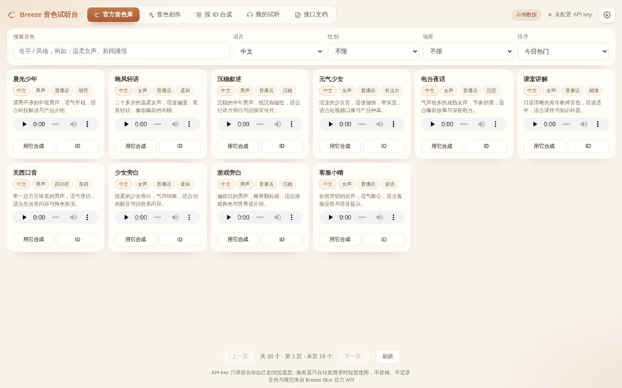
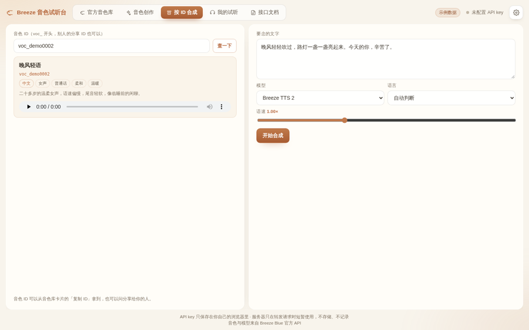
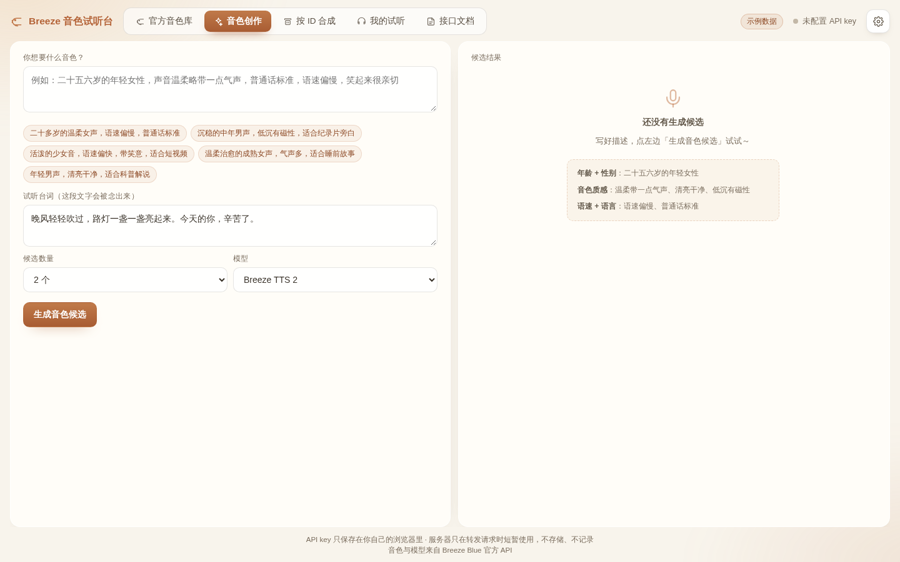
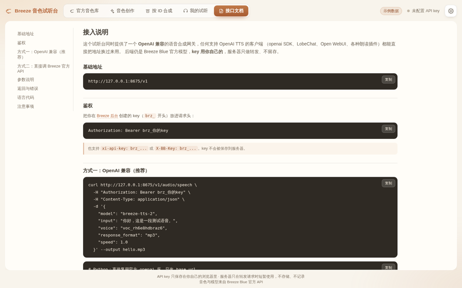
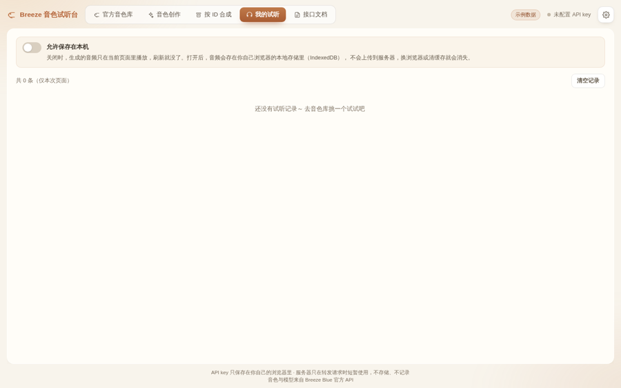
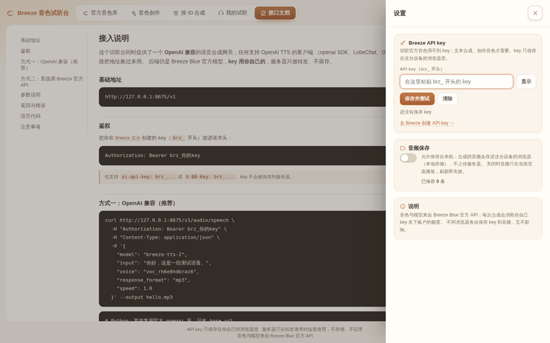

<div align="center">
  
  <h1>Breeze 音色试听台</h1>
  <p>把 Breeze Blue 的音色库变成一个能听、能试、能对比的本地工作台</p>
  <p>浏览官方音色、一句话设计新音色、按音色 ID 直接合成，并把同一套能力以 <b>OpenAI 兼容接口</b> 对外开放。</p>
  <p>
    
    
    
    
  </p>
  <p>
    
    
    
    
    
    
  </p>
</div>

## 项目简介

这是一个单机可跑的音色工作台：后端用 Flask 做一层很薄的代理，前端是一个不用构建、不用框架的单文件页面。

它解决三个日常问题：**官方音色太多了不知道选哪个**（一万五千多个，只能靠名字猜）、**想调一个属于自己的音色但没有录音样本**（用一句话描述就能生成候选）、**合成只能回官网点按钮**（这里可以按音色 ID 批量、也可被任何 OpenAI 兼容客户端调用）。

所有 API key 只保存在**你自己的浏览器**里，服务器只在单次请求中转发一次，不写库、不写日志、不进 URL。没有配置任何凭据时，音色库会显示**内置示例数据**，clone 下来直接 `python app.py` 就能看到完整界面。

## 界面预览

<table>
  <tr>
    <td align="center"><strong>官方音色库</strong><br></td>
    <td align="center"><strong>按 ID 合成</strong><br></td>
    <td align="center"><strong>音色创作</strong><br></td>
  </tr>
  <tr>
    <td align="center"><strong>接口文档</strong><br></td>
    <td align="center"><strong>我的试听</strong><br></td>
    <td align="center"><strong>设置</strong><br></td>
  </tr>
</table>

## 功能特性

| 页面 | 能做什么 |
| --- | --- |
| **官方音色库** | 搜索（支持语义检索）、语言 / 性别 / 场景筛选、今日热门排序；卡片自带官方预览音频，一键「用它合成」或复制音色 ID |
| **按 ID 合成** | 粘贴任意 `voc_` 开头的音色 ID（包括别人分享给你的），先看清它是谁的声音，再调语速 0.5×~2.0× 合成 |
| **音色创作** | 用一句话描述想要的音色（年龄 / 质感 / 语速 / 语言），一次生成 1~3 个候选，试听后保存进自己的音色库，之后可反复合成 |
| **我的试听** | 合成记录列表，可播放、下载、删除；**默认只在内存**，手动打开「允许保存在本机」才写入浏览器 IndexedDB |
| **接口文档** | 站内即是一份可复制的接入文档：curl / Python / Node 三种示例，参数表与错误码表 |

### 交互与工程细节

- **整页不滚动**：网格按容器实时宽高算行列（1920 屏 8×4=32 张，1440 屏 6×3=18 张），翻页代替无限滚动；窗口缩放会自动重排。
- **一次只播一个音频**：点第二个音色的试听，第一个自动暂停，不会几个声音叠在一起。
- **多个浏览器互不干扰**：key 与音频都在各自的浏览器本地，换人用只需在设置里填自己的 key。
- **零构建**：Template 里内联 CSS/JS，没有 npm、没有打包步骤。

## 快速开始

```bash
git clone https://github.com/JunWan666/breeze-voice-studio.git
cd breeze-voice-studio

python3 -m venv venv
source venv/bin/activate          # Windows: venv\Scripts\activate
pip install -r requirements.txt

python app.py                     # 打开 http://127.0.0.1:8674
```

首次打开会看到顶栏的「示例数据」标记 —— 说明当前用的是内置的 12 个示例音色。

想接真实音色库，有两种方式（任选其一）：

1. **用自己的 API key（推荐）**：右上角齿轮 → 填 `brz_` 开头的 key → 保存并测试。key 存在浏览器里，音色库、合成、创作全部可用。
2. **给服务器配一个 Breeze 登录态**：把浏览器里 `breezeblue.ai` 的 `breeze_blue_session` cookie 导出成 JSON，放到 `~/.config/breezeblue/cookies.json`（或用环境变量 `BREEZE_COOKIE_FILE` 指到别处）。这样**不填 key 也能浏览**官方音色库，但合成仍需要 key。

### 方式二：Docker

不装 Python，直接用现成镜像（多架构，`amd64` / `arm64` 都支持，NAS 和树莓派也能跑）：

```bash
docker run -d --name breeze-voice -p 8674:8674 \
  ghcr.io/junwan666/breeze-voice-studio:latest
```

想自己从源码构建：

```bash
docker compose up -d                 # 默认映射 8674 端口，数据目录 ./data
# 或
docker build -t breeze-voice . && docker run -d -p 8674:8674 breeze-voice
```

宿主机端口被占用时用 `PORT=9000 docker compose up -d`。

镜像基于 `python:3.12-slim`，压缩后约 **45 MB**，以非 root 用户（uid 10001）运行，自带健康检查（每 30 秒探一次 `/healthz`），`restart: unless-stopped` 保证异常自启。

镜像由 GitHub Actions 在打 `v*` 标签时自动构建，多架构并行发布；也可以在仓库的 **Actions → Build & Push Docker Image → Run workflow** 手动触发，并指定任意 tag。

想把服务端登录态也带进容器：把导出的 cookie 存成 `./data/cookies.json`（compose 已把 `./data` 挂到容器内的 `/data`），重启容器生效；不放就自动进入演示模式。

### 配置项

| 环境变量 | 默认值 | 说明 |
| --- | --- | --- |
| `HOST` | `0.0.0.0` | 监听地址 |
| `PORT` | `8674` | 监听端口 |
| `BREEZE_COOKIE_FILE` | `~/.config/breezeblue/cookies.json` | 服务端只读用的登录态文件；不存在则进入演示模式 |

## OpenAI 兼容接口

Breeze 官方没有 OpenAI 兼容端点，所以本项目自带了一层很薄的转换：任何支持自定义 `base_url` 的客户端（openai SDK、LobeChat、Open WebUI、朗读插件）都能直接用。

```bash
curl http://127.0.0.1:8674/v1/audio/speech \
  -H "Authorization: Bearer brz_你的key" \
  -H "Content-Type: application/json" \
  -d '{
    "model": "breeze-tts-2",
    "input": "你好，这是一段测试语音。",
    "voice": "voc_xxxxxxxxxxxx",
    "response_format": "mp3",
    "speed": 1.0
  }' --output hello.mp3
```

```python
from openai import OpenAI

client = OpenAI(base_url="http://127.0.0.1:8674/v1", api_key="brz_你的key")

resp = client.audio.speech.create(
    model="breeze-tts-2",
    voice="voc_xxxxxxxxxxxx",
    input="你好，这是一段测试语音。",
    response_format="mp3",
)
open("hello.mp3", "wb").write(resp.read())
```

| 参数 | 必填 | 说明 |
| --- | --- | --- |
| `input` | 是 | 要合成的文字，最长 2000 字 |
| `voice` | 是 | Breeze 音色 ID，`voc_` 开头 |
| `model` | 否 | `breeze-tts-2`（中/英）或 `breeze-tts-2-multilingual`（51 种语言）；也接受 `tts-1` 等别名 |
| `response_format` | 否 | `mp3`（默认）/ `wav` / `opus` / `aac` / `flac` / `pcm` |
| `speed` | 否 | 0.5 ~ 2.0，保持音高不变 |
| `instructions` | 否 | 表演指令，例如「用轻快的语气，句尾上扬」 |
| `language` | 否 | ISO 639-1 语言码，不传则由模型判断 |

另提供 `GET /v1/models`（OpenAI 风格模型列表）与 `GET /api/voice-info?voice_id=voc_xxx`（查单个音色）。错误统一为 OpenAI 结构 `{"error": {"message", "type", "code"}}`。

## 目录结构

```
breeze-voice-studio/
├── app.py                 # Flask 路由：页面 / 代理 / OpenAI 兼容层
├── bb_api.py              # Breeze Developer API 客户端 + 示例数据（演示模式）
├── templates/index.html   # 单文件前端（内联 CSS + JS，5 个标签页）
├── static/demo-preview.mp3# 演示模式的试听占位音
├── docs/                  # README 用的 logo 与截图
├── Dockerfile             # python:3.12-slim + waitress，非 root 运行
├── docker-compose.yml     # 端口映射 + /data 挂载 + 自动重启
├── .github/workflows/     # 打 v* 标签自动构建多架构镜像（GHCR / Docker Hub）
└── requirements.txt
```

## 关于密钥与隐私

- API key 存在浏览器的 `localStorage`，**每次请求才临时发给后端转发**；后端不写数据库、不写日志、不拼进 URL，日志里出现 `brz_` 字样会被自动打码。
- 音频默认只在页面内存中存活；「允许保存在本机」打开后才写入浏览器 IndexedDB，**不会上传服务器**。
- 不同浏览器 = 不同身份，天然隔离；把地址分享给朋友，他用自己的 key、看自己的记录。
- 如果部署到公网，建议再加一层访问密码或反向代理鉴权，避免别人白用你的服务器带宽。

## 与 Breeze Blue 的关系

本项目**不是** Breeze Blue 官方项目，只是围绕其公开的 Developer API 做的第三方客户端。音色、模型、额度都归 Breeze Blue 所有，使用时请遵守其服务条款；合成会消耗**你自己账号**的额度。

接口细节参考官方文档：<https://docs.breezeblue.ai>

## 许可证

[MIT](./LICENSE) © 2026 JunWan666
